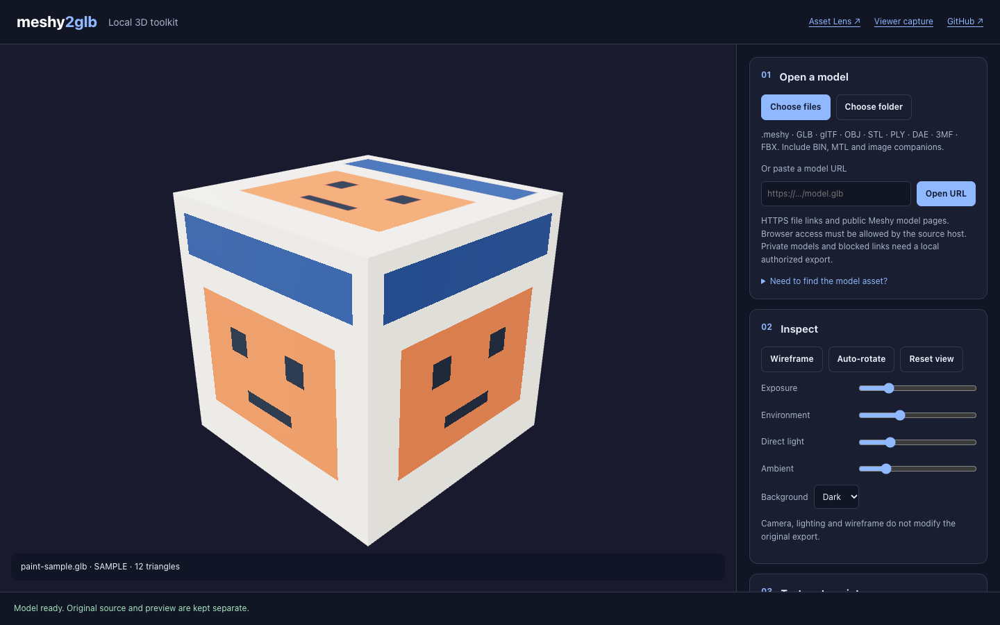
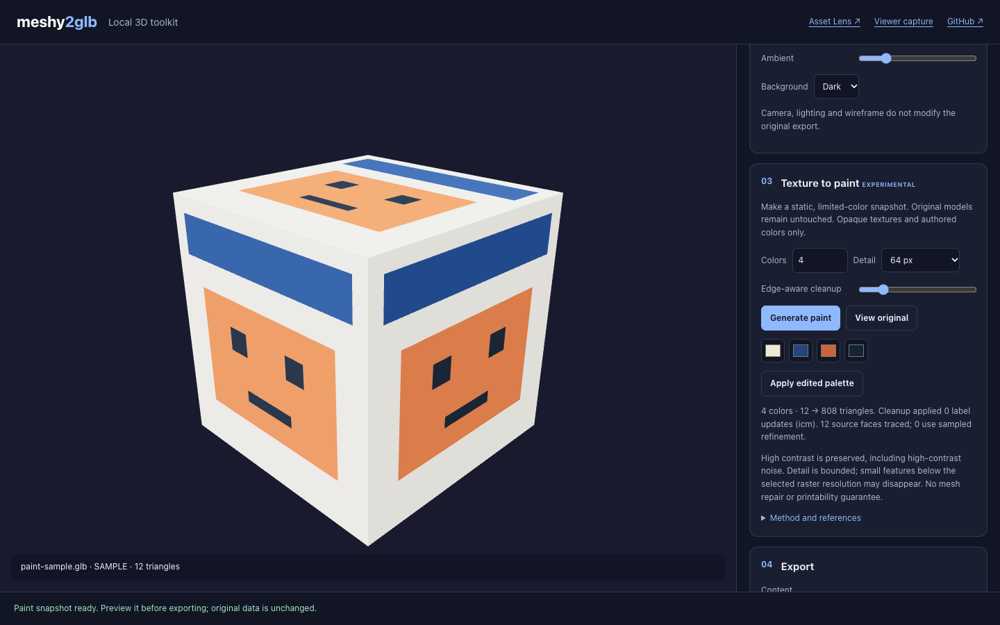

# meshy2glb

[](https://github.com/Amal-David/meshy2glb/actions/workflows/test.yml)
[](https://github.com/Amal-David/meshy2glb/actions/workflows/pages-smoke.yml)
[](LICENSE)

A browser app that opens `.meshy` files and other 3D models, lets you inspect them, and exports them as GLB, glTF, OBJ, STL, PLY, USDZ or a painted 3MF for 3D printing.

**[Open the app → amal-david.github.io/meshy2glb](https://amal-david.github.io/meshy2glb/)**

Conversion runs in your browser. Models are not uploaded anywhere, and there is no account, analytics or install step.



## Contents

- [Features](#features)
- [Quick start](#quick-start)
- [Supported formats](#supported-formats)
- [Usage](#usage)
- [Texture to paint (experimental)](#texture-to-paint-experimental)
- [Chrome extension (optional)](#chrome-extension-optional)
- [How `.meshy` decoding works](#how-meshy-decoding-works)
- [Privacy](#privacy)
- [Limitations](#limitations)
- [Troubleshooting](#troubleshooting)
- [Development](#development)
- [Project structure](#project-structure)
- [Documentation](#documentation)
- [Credits](#credits)
- [License](#license)

## Features

- **Open `.meshy` files.** Decrypts and decompresses Meshy's container into a standard GLB that Blender, Unity, Unreal and other glTF tools can read.
- **Open common 3D formats.** GLB, glTF, OBJ, STL, PLY, DAE, 3MF and FBX, from files, a whole folder, or an HTTPS link.
- **Inspect the model.** Orbit camera, wireframe, auto-rotate, exposure and lighting sliders, background presets and animation-clip preview.
- **Export.** GLB, glTF, OBJ, STL, PLY and USDZ. The app shows what each format keeps and drops before you export.
- **Texture to paint (experimental).** Reduce a textured model to 2–16 colors and export a painted 3MF for PrusaSlicer 2, Bambu Studio or OrcaSlicer.
- **Chrome extension (optional).** Save the visible geometry from a Three.js viewer on a page you are allowed to export from.

## Quick start

1. Open **[amal-david.github.io/meshy2glb](https://amal-david.github.io/meshy2glb/)**.
2. Drop a model onto the page, click **Choose files**, or paste a URL and click **Open URL**. To try the app without a file, click **Try a textured sample**.
3. Inspect the model in the viewer.
4. In **Export**, pick the content and format, then click **Export**.

To run it on your own machine instead, see [Development](#development).

## Supported formats

### Import

| Format | Notes |
| --- | --- |
| `.meshy` | Meshy container, version 1. Converted to a standard GLB. |
| GLB | Original bytes are kept for GLB export when possible. |
| glTF | Select the `.bin` and texture files too, or use **Choose folder**. |
| OBJ | Select the `.mtl` and texture files too, or use **Choose folder**. |
| STL, PLY, DAE, 3MF, FBX | Loaded through the Three.js loaders. |

Files up to 256 MiB are accepted. The app opens one model at a time; it is not a batch converter.

### Export

| Format | What it keeps |
| --- | --- |
| GLB | Original bytes when available; otherwise regenerated scene data and animation clips. |
| glTF | Self-contained file with embedded resources and supported clips. |
| OBJ | Geometry and UVs. No `.mtl`, textures or animation. |
| STL | Geometry only. Binary STL, no units recorded. |
| PLY | Geometry, normals and vertex colors. No image textures. |
| USDZ | Static model for AR Quick Look. Rejects rigged, instanced, multi-material and vertex-colored meshes instead of exporting them incorrectly. |
| Painted 3MF | Only for a painted snapshot. Up to 16 filament regions. |

## Usage

### Open a model

- **Files.** Drag files onto the page or click **Choose files**. For glTF and OBJ, include the companion `.bin`, `.mtl` and image files in the same selection.
- **Folders.** **Choose folder** keeps relative paths, so textures referenced as `textures/wood.png` resolve. If two files in the folder share a name and the reference is ambiguous, the app reports an error rather than guessing.
- **URLs.** Paste a direct HTTPS link to a model file, or a public Meshy model page (`https://www.meshy.ai/3d-models/...`). The source server must allow cross-origin (CORS) requests from the browser. The app does not use a proxy and does not send cookies, so private, expired or login-protected links will not open; download those files and open them locally.

Another page can prefill the URL field by linking to `https://amal-david.github.io/meshy2glb/#url=<encoded HTTPS URL>`. Nothing is fetched until you click **Open URL**.

To find a model's URL on a web page, use the companion [Asset Lens](https://github.com/Amal-David/asset-capture) extension.

### Inspect

The **Inspect** panel controls the preview only: wireframe, auto-rotate, reset view, exposure, environment, direct and ambient light, and background (dark, light or black). None of these settings change what gets exported.

### Export

Pick what to export under **Content**, then a **Format**:

| Content | What you get |
| --- | --- |
| Original asset | The model as loaded. A `.meshy` file exports as its decompressed GLB. |
| Painted static snapshot | The limited-color result from [Texture to paint](#texture-to-paint-experimental), as a vertex-colored GLB or a painted 3MF. |
| Displayed geometry only (static) | The current pose baked into a static GLB, without textures, normals, rigs or animation. GLB only. |

## Texture to paint (experimental)



This turns a textured model into a small set of flat color regions that a multi-material 3D printer can print.

1. Load a textured model, or click **Try a textured sample**.
2. In **Texture to paint**, set **Colors** (2–16), **Detail** (existing faces, or 64–512 px) and **Edge-aware cleanup**.
3. Click **Generate paint**. Use **View original** to compare.
4. Optionally click a swatch to change a color, then **Apply edited palette**.
5. In **Export**, choose **Painted static snapshot** and **Painted 3MF**. Pick the **Slicer encoding** (PrusaSlicer 2, Bambu Studio or OrcaSlicer) and **Millimeters per model unit**.
6. Open the 3MF in your slicer and assign filaments to each color.

The default scale is 1000 mm per unit because glTF uses meters. Change it if your model uses other units.

The result is a static, painted surface. It does not repair meshes, check printability, keep animation, or handle transparent textures. Details smaller than the chosen resolution may disappear. The color fitting uses Oklab, and cleanup keeps edges where the source texture has strong contrast; [docs/ALGORITHM.md](docs/ALGORITHM.md) has the method, budgets and a benchmark against Texture2Paint.

The 3MF writer is reused from [EllsworOpan's Texture2Paint](https://github.com/EllsworOpan/Texture2Paint) under its MIT license.

## Chrome extension (optional)

The extension saves the geometry that a Three.js viewer is currently showing, for pages where you have permission to export the model.

```bash
npm ci
npm run build:extension
```

Then in Chrome:

1. Open `chrome://extensions` and turn on **Developer mode**.
2. Click **Load unpacked** and select the `dist-extension` folder.
3. On the model's page, click the extension icon, then **Scan this tab**.
4. Select the meshes you want and save the GLB.
5. Open that GLB in meshy2glb to convert it to another format.

The extension asks only for `activeTab` and `scripting`, and runs on a page only after you click **Scan this tab**. It saves geometry only: no materials, textures, rigs or animation, and up to 250,000 triangles. It cannot capture closed or non-Three.js renderers, and it may not work on Meshy's own viewer. See [docs/INTEGRATIONS.md](docs/INTEGRATIONS.md) for details and for exposing a scene from your own app.

## How `.meshy` decoding works

A `.meshy` file is a GLB wrapped in a thin encryption layer:

```text
Offset        Contents
0..7          magic "MESHY.AI"
8..9          version (uint16 LE, 1)
10..21        12-byte AES nonce
22..31        reserved
32..8224      AES-256-CTR ciphertext (always 8192 bytes)
8224..8240    16-byte AES-GCM tag (skipped)
8240..EOF     plaintext: textures and meshopt-compressed streams
```

1. **Decrypt** the first 8 KB with AES-256-CTR using WebCrypto (`src/decrypt.js`).
2. **Decompress** every `EXT_meshopt_compression` buffer view with [meshoptimizer](https://github.com/zeux/meshoptimizer)'s decoder (`src/decompress.js`).
3. **Validate** the result as a standard GLB (`src/glb.js`), then load it into the viewer.

The decoder was written from reverse engineering; it does not ship Meshy's WASM. [NOTES.md](NOTES.md) records how the format was worked out, including the dead ends. Meshy can change the format at any time, which would break this decoder.

## Privacy

- Model files are processed in the browser and never uploaded.
- **Open URL** contacts only the host in the URL (and, for Meshy pages, Meshy's public task endpoint), with cookies and referrer turned off.
- The page loads Three.js `0.169.0` from a CDN, so the first visit needs a network connection.
- No analytics or session recording.

Only convert or export models you own or have permission to use.

## Limitations

- Draco- and KTX2-compressed glTF files are not decoded.
- Only `.meshy` version 1 is supported.
- OBJ export does not include an `.mtl` file or textures.
- Custom glTF extensions may be lost when a GLB is regenerated rather than passed through.
- The Meshy URL resolver uses an undocumented public endpoint and can stop working without notice.

## Troubleshooting

| Problem | Fix |
| --- | --- |
| A URL fails to open | The host probably blocks cross-origin requests, or the link is private or expired. Download the file and open it locally. |
| A glTF or OBJ loads without textures | Select the `.bin`, `.mtl` and image files together with the model, or use **Choose folder**. |
| "Unsupported .meshy version" | The file uses a newer container than this decoder knows. Please open an issue. |
| Nothing works when running locally | WebCrypto needs a secure origin. Serve over `http://localhost` (as `./start.sh` does) or HTTPS, not `file://` or a LAN IP. |
| USDZ export is refused | The model has rigs, instancing, multiple materials or vertex colors. Export GLB instead. |
| A 3MF prints at the wrong size | Set **Millimeters per model unit** to match the model's units before exporting. |

## Development

The site is static files with no build step. To serve it locally:

```bash
git clone https://github.com/Amal-David/meshy2glb.git
cd meshy2glb
./start.sh
```

This serves the repository at `http://localhost:8765/` using Python's built-in server. Set `PORT` to change the port.

Tests need Node 22:

```bash
npm ci
npm test                         # unit tests; also builds the extension
npm run test:legacy              # decoder tests against .meshy files in tests/fixtures/
npx playwright install chromium
npm run test:browser             # end-to-end export tests in Chromium
npm run benchmark                # paint cleanup benchmark, writes docs/benchmark.json
```

`tests/fixtures/` is git-ignored, so the `.meshy` fixture tests skip unless you add your own files there or point `MESHY_FIXTURES` at a folder of them.

CI runs all of the above on every push and pull request ([test.yml](.github/workflows/test.yml)). Pushing to `main` publishes the site through GitHub Pages; a second workflow ([pages-smoke.yml](.github/workflows/pages-smoke.yml)) then checks that the live files match the commit. See [docs/DEPLOYMENT.md](docs/DEPLOYMENT.md).

## Project structure

```text
index.html                 App page
src/
  app.js                   UI wiring
  input.js                 File, folder and URL input
  model-loader.js          Picks a loader and resolves companion files
  decrypt.js               .meshy → GLB (AES-256-CTR)
  decompress.js            meshopt decompression
  glb.js                   GLB parsing and validation
  viewer.js                Three.js preview scene
  export.js                Export routes for each format
  snapshot.js              Bakes visible geometry into a static mesh
  discovery.js             Finds Three.js scenes on a page (extension)
  paint-core.js            Palette fitting and label cleanup
  binary-cut.js            Min-cut solver for two-color cleanup
  contours.js, surface.js  Splits the mesh along color boundaries
  paint-adapter.js         Three.js and 3MF output for painted models
  vendor/three-mf/         3MF writer from Texture2Paint (MIT)
extension/                 Chrome extension source
scripts/                   Extension build, benchmark, Pages check
tests/                     Unit, legacy decoder and Playwright tests
docs/                      Longer documentation
```

## Documentation

| Document | Contents |
| --- | --- |
| [docs/ALGORITHM.md](docs/ALGORITHM.md) | Texture-to-paint method, limits and benchmark |
| [docs/INTEGRATIONS.md](docs/INTEGRATIONS.md) | URL import, Asset Lens and the Chrome extension |
| [docs/DEPLOYMENT.md](docs/DEPLOYMENT.md) | GitHub Pages setup and live-site check |
| [docs/THIRD_PARTY.md](docs/THIRD_PARTY.md) | Reused code, licenses and attributions |
| [NOTES.md](NOTES.md) | How the `.meshy` format was reverse engineered |

## Credits

- [three.js](https://threejs.org/): rendering, loaders and exporters (MIT)
- [meshoptimizer](https://github.com/zeux/meshoptimizer): mesh decompression (MIT)
- [Texture2Paint](https://github.com/EllsworOpan/Texture2Paint): 3MF writer and cleanup reference (MIT)
- [Oklab](https://bottosson.github.io/posts/oklab/) by Björn Ottosson: color space for palette fitting
- [youssef02/meshy2glb](https://github.com/youssef02/meshy2glb), [Pouare514/meshy-downloader](https://github.com/Pouare514/meshy-downloader), [MeshySec](https://github.com/imluri/MeshySec) and [meshy-glb-downloader](https://github.com/Shuvam-Banerji-Seal/meshy-glb-downloader): earlier tools and ideas

Full details are in [docs/THIRD_PARTY.md](docs/THIRD_PARTY.md).

Not affiliated with Meshy AI.

## License

[MIT](LICENSE)
